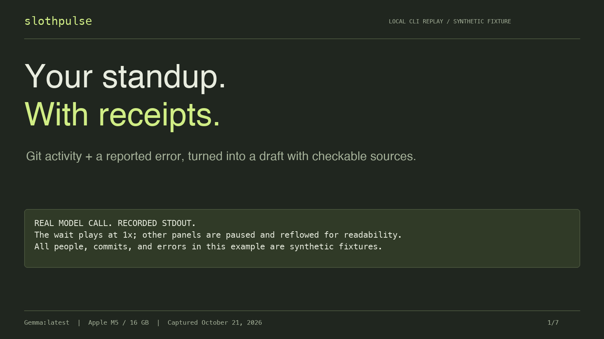

# Recorded demonstration

[Watch the 48-second MP4](https://raw.githubusercontent.com/TengByte/slothpulse/main/demo-assets/demo.mp4).

## Provenance

- The fixture is synthetic and generated by [make_demo.py](make_demo.py). The authors and fake credential are demonstration data.
- The worker actually raises `KeyError: 'result'`; its trace is captured rather than invented.
- [benchmark.py](benchmark.py) runs the real CLI against downloaded local Gemma, captures timestamped stdout, and saves a [terminal cast](demo-assets/session.cast).
- The MP4 is a presentation replay of that cast, with explanatory title and source cards. The recorded model wait is played at 1×; explanatory cards are held for readability. It is not a screen capture of a live shell session.
- The captured CLI reports **10.33 s**; external process measurement is **10.396 s**. All output and references come from the committed [run.json](demo-assets/run.json).
- Full environment, nine-run results, and limitations: [BENCHMARK.md](BENCHMARK.md).

## Files

| Artifact | Contents |
| --- | --- |
| [digest.md](demo-assets/digest.md) | Actual rendered Markdown from the captured run |
| [run.json](demo-assets/run.json) | Sanitized evidence, validated plan, Ollama metrics |
| [transcript.txt](demo-assets/transcript.txt) | Captured terminal output |
| [session.cast](demo-assets/session.cast) | Timestamped terminal replay source |
| [benchmark.json](demo-assets/benchmark.json) | All nine final real-model measurements |
| [demo.mp4](demo-assets/demo.mp4) | 47.5-second video presentation |
| [poster.png](demo-assets/poster.png) | Video title card |
| [website/](website/) | Buildless interactive source explorer using the recorded data |

The interactive website is a recorded-data demonstration. It does not run inference, accept private input, or read a visitor's repository. Serve it locally with `python3 -m http.server 8765 --directory website`.

## Reproduce the workflow

Follow the [README](README.md#reproduce-the-demo). `python3 benchmark.py --runs 3` repeats all three scenarios. The benchmark regenerates text, JSON, and cast artifacts; video/poster rendering is separate. A different day's fixture will have different commit hashes and timestamps.

The application still requires a human to review its interpretations. Source validation is not a semantic accuracy guarantee.
